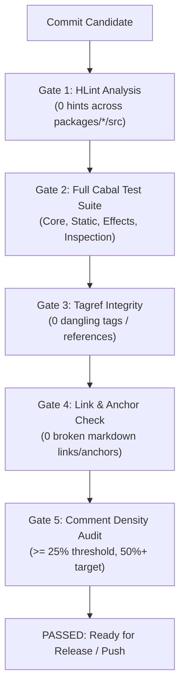

<!--
SPDX-License-Identifier: EUPL-1.2 OR Apache-2.0
-->
# `penelope` Maintainer Guide & Engineering Governance

**Status:** LIVING DOCUMENT · v1.0 · 2026-11-03  
**Audience:** Maintainers, Subsystem Leads, Ecosystem Contributors, AI Assistant Drivers  
**Canonical Strategy:** [`docs/notes/DOC_STRATEGY.md`](notes/DOC_STRATEGY.md) · [`docs/notes/PENELOPE_DESIGN.md`](notes/PENELOPE_DESIGN.md)  
**Corpus Inventory:** [`docs/INDEX.md`](INDEX.md) · **Implementation Plan:** [`docs/notes/IMPLEMENTATION_PLAN.md`](notes/IMPLEMENTATION_PLAN.md)  
**Newbie Guide:** [`docs/NEWBIE_GUIDE.md`](NEWBIE_GUIDE.md) · **Interactive Tutorial:** [`docs/TUTORIAL.md`](TUTORIAL.md)

---

## 1. Architectural Foundations & Invariants

Maintainers must protect seven load-bearing architectural invariants governing `penelope`:

### 1.1 Unpacked GADT Representation on the Hot Path
Traditional Freer effect systems allocate intermediate 1-element wrapper closures on every monadic bind (`>>=`). If each effect operation were wrapped in a standard generic `Rep` (`Rep !Word !(SmallArray (f Any))`), an extra 1-element `SmallArray#` heap object would be allocated on every single effect invocation.

Penelope solves this by **unpacking the Polytropos variant tag (`Word#`) and payload (`Any`) directly into the `Penelope` GADT constructors** (`OpF`, `OpH`). Flat Polytropos records (`SmallArray`) are reserved strictly for multi-branch continuations, region bundles, and dispatch vectors. In GHC Core, injecting an effect compiles down to loading an unboxed machine word constant into a register—with **zero residual dictionary allocations**.

### 1.2 Pure Static Routing via Reified Row Morphisms (`RowMorph`)
In arrow-based pipelines, rearranging channels historically required opaque `arr (\(a, (b, c)) -> (b, a))` lambdas. These lambdas are opaque black boxes to GHC: they cannot be inspected or fused.

In `penelope`, pure channel permutations are reified as **`RowMorph` index arrays** (`PrimArray Int`). A `Route (morph :: RowMorph outs ins)` node statically maps source port slots to destination port slots. Sequential composition of route nodes (`Route m1 >>> Route m2`) **fuses immediately at construction time** via `composeRowMorph` in $O(|outs|)$ time. The syntax tree never grows, and no closure is allocated.

### 1.3 Frame-Rule Automatic Port Wiring (`>&>`)
Passing intermediate registers across sequential stages is managed via `(>&>)`. Using the `FrameWire` constraint synthesized by `polytropos-plugin`, `(>&>)` automatically:
1. Gathers an operation's required input ports from the live ambient register frame.
2. Executes the operation.
3. Scatters the updated output ports back into the frame.
4. Preserves all untouched ambient frame registers in $O(|frame|)$ time.

### 1.4 Two-Phase Separation: Weaving vs. Unweaving
Execution is strictly partitioned into two disjoint phases:
1. **Phase 1: Weaving (`elaborateAll`):**  
   A single-pass bottom-up tree transformation translating higher-order scoped sub-regions in `eh` into pure first-order operations in `ef`. Scoped handlers cannot escape their lexical boundary.
2. **Phase 2: Unweaving (`interpretAll`):**  
   Bulk, vector-dispatched algebraic interpretation over first-order effects `ef`. The handler dispatch table is a flat `SmallArray` indexed directly by the unboxed `Word#` constructor tag, executing in branchless $O(1)$ time without typeclass search.

### 1.5 Zero-Traversal Weakening via Institutional Satisfaction
Subprograms with small effect signatures are embedded into larger outer pipelines without walking the syntax tree:
$$\operatorname{eval}_J(\mathcal{H}, \sigma_*(P)) \equiv \operatorname{eval}_I(\sigma^*(\mathcal{H}), P)$$

Rather than rewriting the subprogram syntax tree $P$, `penelope` leaves $P$ completely untouched. At `ScopeRow` boundaries, the handler vector $\mathcal{H}$ is reduced contravariantly ($\sigma^*(\mathcal{H}) = \text{gatherRecord } \sigma \text{ } \mathcal{H}$) in $O(|eh_1| + |ef_1|)$ time. Weakening is an instantaneous $O(1)$ pointer coercion over the computation AST.

### 1.6 Generalized Cayley Static Reflection (`penelope-static`)
Because branch continuations and scoped sub-regions remain explicit algebraic nodes in the GADT outside opaque `(->)` closures, `penelope-static` traverses the computation hypergraph prior to execution to extract database schemas, capability strands, and compute exact per-port register liveness.

### 1.7 Zero-Cost Surface Facades (`penelope-effects`)
Ergonomic surface facades (`Eff eh ef a` and `Rope eh ef a b`) are provided as zero-cost `newtype` wrappers over `Penelope`. They must compile down to identical Core representations as raw polycategorical circuits.

---

## 2. The 5-Gate Physical Verification Discipline

Every commit must pass all five physical verification gates via `./bin/penelope-verify`:

```bash
./bin/penelope-verify
```



### Gate 1: HLint Static Analysis
- **Command:** `hlint packages/*/src`
- **Requirement:** Zero hints, zero warnings.

### Gate 2: Full Cabal Test Suite
- **Command:** `cabal test all`
- **Requirement:** 100% test pass rate across all three packages (`penelope-core`, `penelope-static`, `penelope-effects`).

### Gate 3: Tagref Cross-Reference Gate
- **Command:** `./bin/penelope-tagref`
- **Requirement:** All cross-reference tags (`tag:...`) and citations (`ref:...`) must resolve without dangling references. Configured via `tagref.yml`.

### Gate 4: Markdown Link & Anchor Integrity Gate
- **Command:** `./bin/penelope-linkcheck`
- **Requirement:** Zero broken links and zero missing section anchors across all Markdown documents in `docs/` and repository root.

### Gate 5: CLOC Comment Density Gate
- **Command:** `./bin/penelope-cloc --check`
- **Requirement:** Minimum 25.0% comment density in `src/` modules, with a long-term target of 50.0%+.

---

## 3. Inspection Testing Discipline

Formally certifying zero-dictionary GHC Core representations is conducted via `inspection-testing` in [`packages/penelope-core/test/Inspection.hs`](../packages/penelope-core/test/Inspection.hs).

### Invariants Verified by Core Inspection:
1. **Unboxed Tag Emission:** `sendPolyF` and `sendPolyH` must compile down to bare unboxed machine literals (`Word#`).
2. **Zero Residual Typeclass Dictionaries:** Hot paths must contain no residual dictionary passing or method lookups.
3. **Branchless Jump-Table Dispatch:** `elaborateAll` and `interpretAll` must dispatch via direct indexing into `SmallArray#` with zero `eqWord#` cascades.

When GHC upgrades or core refactorings occur, maintainers must run:
```bash
cabal test penelope-core-test --test-options="-p Inspection"
```

---

## 4. Benchmark Regression & Measurement Discipline

Benchmarks are maintained in [`packages/penelope-effects/bench/Main.hs`](../packages/penelope-effects/bench/Main.hs) using `tasty-bench`.

### Execution Discipline
To ensure reproducibility:
1. Compile with isolated package environment:
   ```bash
   cabal bench penelope-effects:bench --benchmark-options="--stdev 1.5 +RTS -T -RTS"
   ```
2. Verify that shallow effect dispatch achieves under $1.5 \text{ ms}$ per 1,000,000 iterations with $0 \text{ bytes}$ nursery allocation beyond the accumulator.
3. Verify that the Coyoneda-fused binary `Rope` pipeline sustains $>40,000,000 \text{ ops/sec}$.

---

## 5. The Two-File Operational Loop & Documentation Precedence

1. **The Precedence Rule (§4 of `DOC_STRATEGY.md`):**  
   > *Code wins at runtime; documentation notes must be corrected in the same change set.*  
   Any commit that alters operational behaviour, changes type signatures, or closes an open question must update the corresponding design note and implementation plan simultaneously.
2. **The Two-File Operational Loop:**  
   - Operational planning is anchored in [`PLAN.md`](../PLAN.md) (strategic roadmap) and [`STATE.md`](../STATE.md) (active session frontier).
   - Before completing any development session or handing off work, maintainers must update [`STATE.md`](../STATE.md) with exact test counts, current git status, and immediate next tasks.
3. **Assistant-Context Budget:**  
   [`AGENTS.md`](../AGENTS.md) is strictly bounded to ~4 KB. Never add detailed prose to `AGENTS.md`; link to canonical documentation in `docs/notes/`.

---

## 6. Git Commit Protocol & Legal Attribution

All commits must follow the imperative-subject plus explanatory body format:

```gitcommit
Short imperative subject line (<= 72 chars)

Explanatory body explaining the problem statement, design rationale,
and invariants preserved.

Assisted-by: <Tool> (<Provider> / <Model>)
Orchestrated-by: <Engine>
```

**Legal Safeguards:**
- **NEVER** use `Co-authored-by:` or `Signed-off-by:` for AI tools.
- Only human developers can certify the Developer Certificate of Origin (DCO).
- See [`docs/notes/COMMIT_ATTRIBUTION.md`](notes/COMMIT_ATTRIBUTION.md) for full policy details.

---

## 7. Release Management & Hackage Publication Protocol

When preparing a release for Hackage:

1. **Version Alignment:** Verify PVP conformance in `packages/*/*.cabal`.
2. **Changelog Updates:** Document all user-facing changes in `packages/*/CHANGELOG.md`.
3. **Cabal Package Verification:**
   ```bash
   cabal check packages/penelope-core
   cabal check packages/penelope-static
   cabal check packages/penelope-effects
   ```
4. **Source Distribution Validation:**
   ```bash
   cabal sdist all
   ```
5. **Physical Gate Sweep:** Run `./bin/penelope-verify` and ensure all 5 gates pass cleanly.
